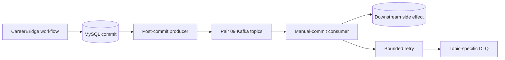

# CareerBridge Kafka architecture (Pair 09)

This document records the local Kafka implementation in the Lab 2 worktree. It is explicit about what is implemented and what still requires additional production hardening.

## Event flow



When Kafka is enabled, supported write workflows insert their business row and `event_outbox` row in the same MySQL transaction. The separate outbox worker publishes after commit and marks delivery only after broker acknowledgement. The default Lab 1 configuration keeps Kafka disabled, preserving existing local behavior.

## Topics

All names are derived from `KAFKA_PREFIX` and currently use `p09`:

- `p09.application.created`
- `p09.application.updated`
- `p09.application.status_changed`
- `p09.event.registration_created`
- `p09.job.created`

Each topic has a corresponding `.dlq` topic created by Compose. `EventEnvelope` validates topic, positive integer aggregate ID, object payload, schema version, event ID, timestamp and trace ID. Logical names may be passed by application code; the contract applies the Pair 09 prefix centrally.

## Producer and consumer responsibilities

- `backend/app/events/producer.py` owns lazy Kafka client creation, keyed publication, broker acknowledgement timeout and safe post-commit failure logging.
- `backend/app/events/consumer.py` owns envelope validation, bounded retry/backoff, duplicate suppression through an injected deduplication store, and manual offset commit after `processed`, `duplicate`, or `dlq` handling.
- Route integrations are in the existing application, job and event write paths. They publish only after `connection.commit()` succeeds and preserve the existing HTTP contracts.
- `event_outbox` and `processed_events` are initialized by the disposable `schema.sql`. The outbox publisher claims rows with a lease, retries failed broker publication, and marks delivery only after broker acknowledgement. Consumer processing inserts the event ID into `processed_events` before the worker returns for manual offset commit.
- The actual guarantee is at-least-once delivery with durable idempotency. It is not exactly-once delivery.

## Local startup

From the repository root, set disposable local values in the shell and run:

```powershell
$env:DB_PASSWORD='local-only-password'
$env:DB_ROOT_PASSWORD='local-only-root-password'
$env:JWT_SECRET='local-only-jwt-secret'
docker compose up --build -d
docker compose ps
docker compose logs kafka-init
```

The Compose stack uses `handshake_lab1_local`, port `13306` for MySQL and port `19092` for the host Kafka listener. It does not target the shared `handshake_lab1` database. Stop it with `docker compose down` after verification; do not add `-v` unless the disposable volume is intentionally being removed.

## Failure demonstrations

Deterministic processor tests cover duplicate suppression and bounded poison retries. The real-broker demonstrations must still be executed and logged in an isolated environment:

1. Publish the same envelope ID twice and show one handler effect plus one duplicate result.
2. Stop a worker before its handler succeeds, restart it, and show that the uncommitted offset is redelivered and the eventual handler effect is idempotent.
3. Publish an invalid/poison event, show the configured retry count and `.dlq` record, then publish a valid event and show that processing continues.

No real-broker result is recorded until those commands have actually run.

Batch 2 real-broker results are recorded in [KAFKA_EVIDENCE_BATCH2.md](KAFKA_EVIDENCE_BATCH2.md).
