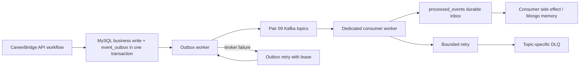

# Kafka Implementation

Updated 2026-11-15 on `fix/student-resume-upload-art-deco`.

## Actual flow



## Contracts and topics

`backend/app/events/contracts.py` owns the versioned `EventEnvelope`. Each
envelope carries `event_id`, `trace_id`, `aggregate_id`, `aggregate_type`,
`occurred_at`, `schema_version`, the fully qualified topic, and a JSON object
payload. The active Pair 09 topics are:

- `p09.application.created`
- `p09.application.updated`
- `p09.application.status_changed`
- `p09.event.registration_created`
- `p09.job.created`
- `p09.memory.updated`
- `p09.memory.consolidate`

Each has a deterministic `.dlq` topic created by the local Kafka initializer.

## Publication and delivery guarantees

Supported workflows enqueue the envelope in `event_outbox` in the same MySQL
transaction as the business row. `publish_pending_once()` leases one pending
row, publishes with broker acknowledgement, and marks it delivered only after
the acknowledgement. Failed publication is retained as `failed` with bounded
exponential retry scheduling.

Consumers disable Kafka auto-commit. `ConsumerProcessor` validates the envelope,
retries handler failures up to the configured limit, and `run_kafka_consumer()`
commits only after a processed, duplicate, or DLQ terminal result. The
`processed_events.event_id` primary key provides durable duplicate claiming
across worker restarts. Delivery is at-least-once; this implementation does not
claim Kafka exactly-once semantics.

The current worker claims the durable inbox row before its memory side effect.
That makes duplicate delivery safe for the implemented worker effect, but a
crash in the narrow interval after the claim and before the side effect would
require reconciliation. The limitation is intentionally documented rather than
described as an atomic cross-store transaction.

## Observability

Producer, processor, worker and DLQ logs include non-sensitive correlation
fields: `event_id`, `trace_id`, `aggregate_id`, `event_type`/topic, outcome,
attempt count, and error type. Raw DLQ records retain the original bounded raw
value plus safe correlation fields when they can be decoded.

## Local commands

From the repository root, with the user's existing secrets configured:

```powershell
docker compose -f docker-compose.yml -f performance/docker-compose.batch7.yml -p p09-performance-batch7 config --quiet
docker compose -f docker-compose.yml -f performance/docker-compose.batch7.yml -p p09-performance-batch7 up -d kafka kafka-init worker outbox-worker
docker compose -f docker-compose.yml -f performance/docker-compose.batch7.yml -p p09-performance-batch7 logs --no-color kafka-init worker outbox-worker
```

Runtime execution was not repeated from this Codex environment because the
Docker Desktop Linux-engine named pipe is permission-denied here.
